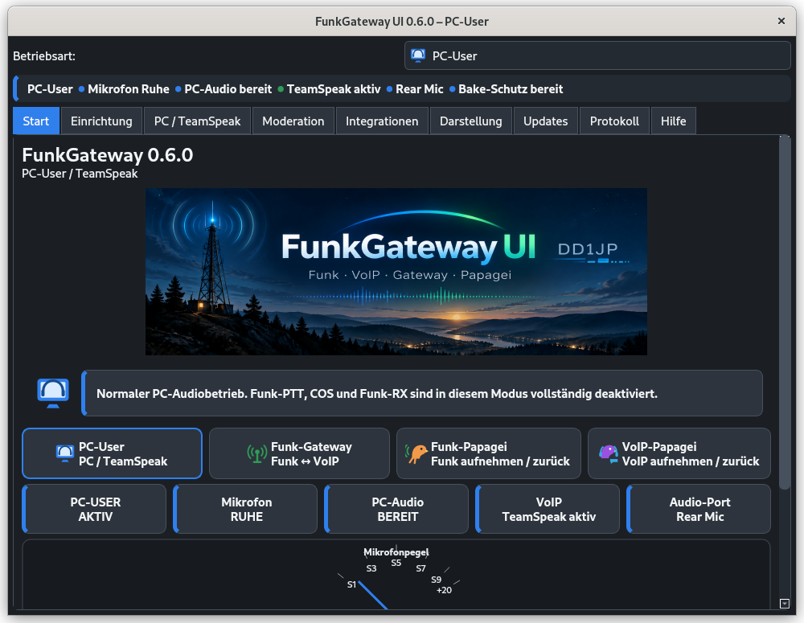
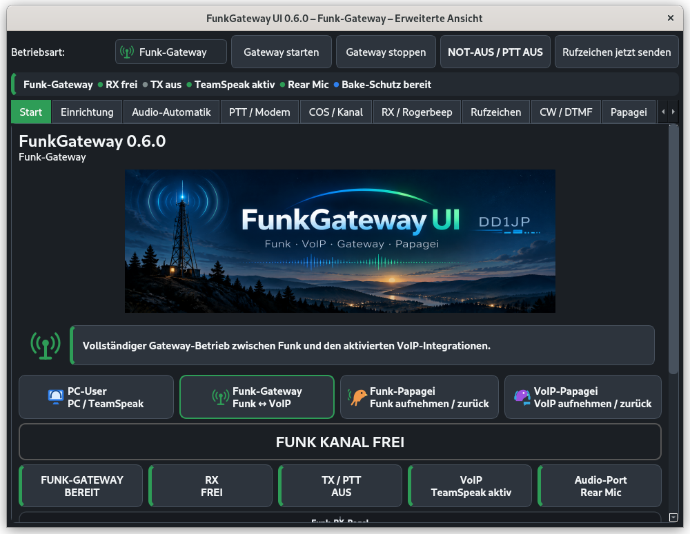
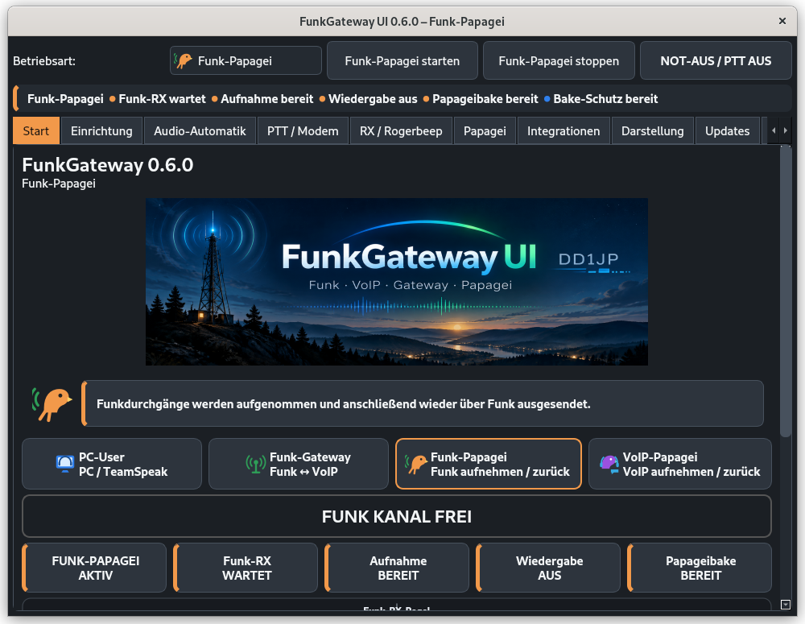
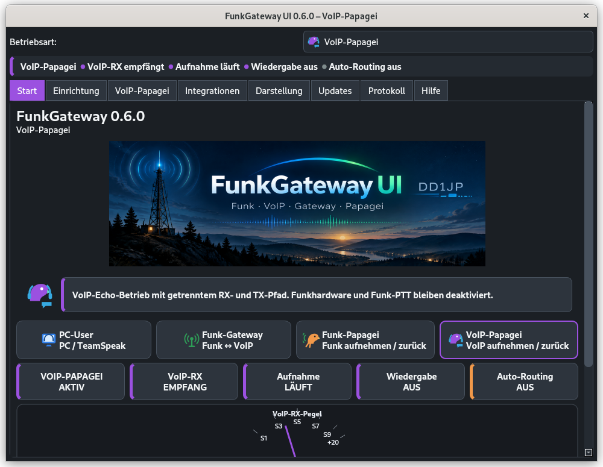

# FunkGateway UI 0.6.13


## Neu: Native FRN-Unterstützung (Alpha)

FunkGateway UI 0.6.9 enthält jetzt eine **native FRN-Integration als Alpha** unter **Integrationen → FRN · Alpha**. Für den FRN-Betrieb ist kein zusätzlicher FRN-Client nötig.

Der aktuelle Alpha-Stand umfasst Server- und Raumlisten über die FRN-SystemManager, direkte Server-Raumlisten über `NET_NAMES`, Teilnehmerliste, RX/TX-Pegel, Raumwechsel und FRN-Audio mit GSM 06.10 WAV49. Die Client-Klasse wird passend zur FunkGateway-Betriebsart gewählt: **PC-User = PC Only (CL=2)**, **Funk-Gateway = Gateway (CL=1)**. Die VX-Kennung bleibt sichtbar und editierbar; der aktuelle Default ist `20261016`.

Die Teilnehmerliste zeigt den Funkzustand direkt an: **grün = verbunden/idle**, **rot = anderer FRN-Teilnehmer spricht**, **orange = FunkGateway selbst sendet** (manuelle PTT oder Gateway-TX). Die Teilnehmerzahl des aktiven Raums wird unmittelbar aus der FRN-Clientliste aktualisiert; die übrigen Raumbelegungen werden schonend etwa alle **20 Sekunden** über den SystemManager nachgeführt.

Die globale **FRN PTT** steht im PC-User-Modus zur Verfügung (Halten oder Klick/Verriegelung, optional mit TX-Zeitbegrenzung). Im Funk-Gateway-Modus gibt es bewusst keine manuelle FRN-PTT: dort folgt der FRN-TX-Zustand dem Gatewaybetrieb.

Die native FRN-Unterstützung ist weiterhin **Alpha**. Unterschiedliche FRN-Servervarianten werden fortlaufend auf Login-, Raumlisten- und Audio-Kompatibilität getestet.

### Komfortablere Gateway- und Hotkey-Auswahl in 0.6.13

Im Mumble-Adminbereich wird der aktuell gesetzte Gateway-Benutzer jetzt direkt angezeigt. Ein markierter verbundener Benutzer kann mit **„Markierten Benutzer als Gateway setzen“** übernommen werden; der aktive Gateway-Benutzer wird in der Liste mit **★** hervorgehoben.

Für FRN PTT muss kein technischer Hotkey-Text mehr eingetippt werden. Über **„Hotkey aufnehmen“** wird die gewünschte Taste direkt gedrückt und übernommen – auch STRG, ALT, SHIFT oder Windows/Super allein.

### FRN-PTT-Hotkeys mit echtem Hold in 0.6.12

STRG, ALT, SHIFT und Windows/Super können einzeln als FRN-PTT-Taste gewählt werden. Im Modus **Halten zum Senden** gilt jetzt wirklich: Taste drücken = TX, Taste loslassen = RX. Im Modus **Klick zum Verriegeln** bleibt das Verhalten: einmal drücken = TX an, erneut drücken = TX aus. Die maximale TX-Zeitbegrenzung bleibt wirksam.

### Ergonomisches Mumble-Adminpanel und FRN-PTT-Hotkey in 0.6.10

Der Mumble-Bereich ist jetzt in **Status**, **Benutzer & Räume**, **Ice / SSH** und **Schutz & Bridge** gegliedert. Benutzer und Räume stehen im Adminpanel direkt nebeneinander; ein gemeinsamer Button aktualisiert beide Listen und der Benutzer→Raum-Workflow ist ohne Dropdown-Suche möglich.

Für die native FRN-PTT gibt es unter **FRN → Audio / PTT** einen frei wählbaren Hotkey (Standard F9, leer = aus). Er gilt innerhalb FunkGateway, schaltet FRN TX ein/aus, ist nur im PC-User-Modus aktiv und respektiert die automatische maximale Sendedauer.

### Mumble-Benutzerverwaltung über Ice in 0.6.9

Im direkten Ice-/SSH-Adminmodus kann FunkGateway jetzt die aktuell verbundenen Mumble-Benutzer aus Murmur laden. Angezeigt werden Benutzername, aktueller Channel, Channel-ID und Live-Session-ID. Ein ausgewählter Benutzer kann mit dem vorhandenen Ice Write-Secret direkt in den ausgewählten Ziel-Channel verschoben werden. Die Liste wird nach einem erfolgreichen Verschieben automatisch neu geladen. Im eingeschränkten Bridge-Modus bleibt diese freie Benutzerverwaltung absichtlich deaktiviert.

### Robustere Mumble-Erkennung in 0.6.8

Die lokale Mumble-Erkennung behandelt die tatsächliche Serververbindung jetzt getrennt von optionalen D-Bus-Zusatzinformationen. Ein Fehler beim Lesen von Sprecherliste, Mute/Deaf oder Transmit-Mode lässt einen verbundenen Mumble-Client nicht mehr fälschlich als getrennt erscheinen. Scheitert bereits die eigentliche Verbindungsabfrage, zeigt FunkGateway statt dauerhaft „Mumble prüft …“ jetzt „Mumble Status unklar“. Teilweise nicht verfügbare Zusatzdaten werden im Mumble-Reiter diagnostisch angezeigt, ohne den Verbindungsstatus zu verlieren.

### Sicherer Passwort-Fallback und manuelle SM-Abfragen in 0.6.7

Der Fallback vom dynamischen FRN-Passwort auf das Hauptpasswort ist jetzt standardmäßig **deaktiviert**. Kann der ausgewählte SystemManager kein dynamisches Passwort liefern, wird die Anmeldung am Sprachserver nicht mehr automatisch mit dem Hauptpasswort versucht. Wer einen bekannten kompatiblen Server bewusst testen möchte, kann **„Hauptpasswort-Fallback erlauben“** einschalten.

Außerdem sind manuelle und automatische SystemManager-Abfragen technisch getrennt. Eine manuelle Abfrage kann einen bereits laufenden Auto-Request nicht mehr nachträglich als „automatisch“ markieren. Fehler bei bewusst manuellen Abfragen lösen weder den automatischen 1/2/5/10-Minuten-Backoff noch die Schutzpause aus.

### Klarere FRN-Diagnose in 0.6.6

FRN-Fehler werden im Diagnosefenster jetzt nach ihrer Herkunft gekennzeichnet: `SYSTEMMANAGER:` für Listen-/Passwortdienste, `FRN-SERVER:` für Verbindungs- und Loginfehler zum eigentlichen Sprachserver, `FRN-SERVER BLOCK:` für echte serverseitige BLOCK-Ablehnungen und `FRN-PROTOKOLL:` für Parser-/Protokollabweichungen. Dadurch ist sofort sichtbar, welche FRN-Ebene gerade Probleme macht.

### FRN Login-1-Kompatibilität in 0.6.5

Einige FRN-Server senden vor der eigentlichen Login-1-Kennung ein führendes NUL-/Steuerbyte, z. B. `\\x002014003`. FunkGateway protokolliert die Rohantwort weiterhin vollständig, entfernt für die eigentliche Prüfung aber führende C0-Steuerzeichen. Dadurch wird `2014003` korrekt als klassische 7-stellige FRN-Antwort akzeptiert. Echte Server-Ablehnungen wie `<AL>BLOCK</AL>` bleiben unverändert echte Fehler und werden nicht umgangen.

### Einstellbare SystemManager-Schutzpause in 0.6.4

Zusätzlich zum normalen Backoff gibt es jetzt eine **einstellbare Schutzpause** für automatische FRN-SystemManager-Abfragen. Sie kann ein- oder ausgeschaltet werden; die Dauer ist zwischen **1 und 120 Minuten** einstellbar (Standard: 15 Minuten). Nach drei aufeinanderfolgenden automatischen Fehlern wird die Automatik für diese Dauer pausiert. **Manuelles „Serverliste laden“ bleibt jederzeit möglich und umgeht die Schutzpause bewusst.** Ein erfolgreicher Abruf setzt Fehlerzähler, Backoff und Schutzstatus zurück. Die Oberfläche zeigt an, ob die Automatik bereit oder noch pausiert ist.

### SystemManager-Schonung in 0.6.3

Die automatische FRN-Server-/Raumbelegungsaktualisierung wurde deutlich defensiver gemacht. Der aktuell verbundene Raum bleibt weiterhin sofort aus der echten Teilnehmerliste aktuell. Für andere Räume fragt FunkGateway im Hintergrund nur noch **einen passenden SystemManager** und standardmäßig nur etwa **alle 3 Minuten** ab. Bei Verbindungsabbruch, Reset oder abgelehntem Verbindungsaufbau greift ein Backoff von **1, 2, 5 und 10 Minuten**, statt sofort erneut anzufragen. Die Auswahl **Alle** wird im Hintergrund nicht mehr als Dreifach-Abfrage verwendet; manuelles Laden bleibt möglich.

### FRN Funk → Netzwerk in 0.6.2

In **Funk-Gateway** und **Funk-Papagei** folgt FRN-TX jetzt direkt dem Funk-RX/VOX-Zustand. Ein gültiger Funkempfang fordert automatisch FRN-TX an und sendet den bereits aufbereiteten Funk-RX aus `FunkGateway_RX_Input`. Nach Funkende wird FRN zuverlässig mit `RX0` auf Empfang zurückgeschaltet.

Auch eine noch ausstehende FRN-TX-Anforderung wird sauber abgebrochen, wenn der Funkträger vor der Serverfreigabe endet. Damit kann FRN nicht mehr in `TX_WAITING` oder `TX_AUDIO` hängenbleiben.

## Neu in 0.6.0: Themes und geschützte Baken

FunkGateway UI 0.6.0 führt Hell-/Dunkel-/Systemdarstellung, sechs abgestimmte Farbschemata und farbige Icons für die vier Betriebsarten ein. Die Textfarbe auf Akzentflächen wird automatisch kontrastreich gewählt.

Automatische Funkansagen sind zusätzlich geschützt: Während Rufzeichenbake, Papageibake sowie internen DTMF-/Schutzansagen wird der VoIP→HF-Weg gesperrt. TeamSpeak/Mumble selbst bleiben dabei lokal hörbar; nach der Ansage wird der Funkweg wieder freigegeben.

**FunkGateway UI** ist ein Open-Source-Linux-Gateway-Controller für Funk ↔ VoIP. Der Core übernimmt Audio-Routing, RX-Erkennung, PTT, Schutzfunktionen, Rogerbeep, Rufzeichenbake und Papagei/Echotest. TeamSpeak und Mumble sind optionale Integrationen.

**Aktuelle stabile Version: 0.6.10**

## Screenshots

Die vier Betriebsarten von FunkGateway UI 0.6.9:

| PC-User | Funk-Gateway |
|---|---|
|  |  |

| Funk-Papagei | VoIP-Papagei |
|---|---|
|  |  |


## Betriebsarten

FunkGateway UI **0.6.9** besitzt vier klar getrennte Betriebsarten:

- **PC-User / TeamSpeak** – normaler PC-/VoIP-Betrieb ohne Funkhardware. Funk-PTT, COS und Funk-RX bleiben vollständig deaktiviert. Die VoIP-Software verwendet ihre normalen **Standard/Default**-Audio-Geräte.
- **Funk-Gateway** – vollständiger Funk ↔ VoIP-Betrieb mit Audio-Routing, RX-Erkennung, PTT, Rogerbeep, Rufzeichenbake, DTMF und Schutzfunktionen.
- **Funk-Papagei** – nimmt einen empfangenen Funkdurchgang auf und sendet ihn anschließend wieder über Funk zurück. Während interner Aussendungen schützt die HF-Isolation vor eingemischtem VoIP-Audio.
- **VoIP-Papagei** – Echo-/Testbetrieb für VoIP mit getrenntem Aufnahme- und Wiedergabepfad. Funkhardware und Funk-PTT bleiben dabei deaktiviert.

Beim Wechsel der Betriebsart übernimmt FunkGateway das Routing unterstützter VoIP-Streams automatisch. In TeamSpeak, Mumble, TeamTalk, Zello und ähnlichen Programmen sollen **Mikrofon/Input und Wiedergabe/Output auf Standard/Default** bleiben; die internen FunkGateway-Audiogeräte müssen normalerweise nicht manuell ausgewählt werden.

## TeamSpeak-Moderation im PC-Modus

Ab **0.5.9.28** bietet der PC-/TeamSpeak-Modus manuelle Moderationsfunktionen: Poke, Verschieben, Channel-Kick und Server-Kick. Die Funktionen arbeiten ausschließlich mit den Rechten des angemeldeten TeamSpeak-Clients. Kritische Aktionen benötigen eine Bestätigung.

## Einfache und erweiterte Gateway-Ansicht

Ab **0.5.9.28** startet der Funk-Gateway-Modus mit einer vereinfachten Oberfläche. Auf der Startseite kann mit **„Erweiterte Einstellungen anzeigen“** jederzeit auf die vollständige Gateway-Oberfläche umgeschaltet werden.

In der einfachen Ansicht bleiben die für den normalen Betrieb wichtigsten Bereiche sichtbar: Start, Audio, PTT, RX/Rogerbeep, Rufzeichen, Papagei, DTMF, Integrationen, Updates, Protokoll und Hilfe. Zusätzliche Feinabstimmungs- und Expertenseiten werden erst in der erweiterten Ansicht eingeblendet.

Der Reiter **Moderation** gehört ausschließlich zum Modus **PC / TeamSpeak** und wird im Funk-Gateway-Modus grundsätzlich nicht angezeigt.

### Vereinfachung innerhalb der Reiter

Die einfache Ansicht blendet nicht nur ganze Expertenreiter aus. Auch auf den weiterhin sichtbaren Seiten werden technische Feinwerte verborgen, wenn für den normalen Betrieb ein bewährter Standard ausreicht. Dazu gehören beispielsweise PTT-/Rogerbeep-Timings, Papagei-Vorlauf/Nachlauf und DTMF-Protokollzeiten.

Die Werte bleiben intern aktiv. Auf neuen Installationen gelten die voreingestellten Standardwerte. Bereits vorhandene benutzerdefinierte Einstellungen werden durch das Umschalten zwischen einfacher und erweiterter Ansicht nicht verändert.

## Einrichtung, Diagnose und Profile

Ab **0.5.9.28** bündelt die Startseite die letzten Funktionsbausteine vor dem Design-Fokus:

- Eigener Reiter **Einrichtung** mit Schritt-für-Schritt-Assistent (Zurück/Weiter) ohne automatisches Senden
- Selbsttest für Audio, PTT, Konfiguration und aktivierte VoIP-Integrationen
- Konfigurations-Backup und Wiederherstellung
- lokale benannte Profile
- kompakte Systemstatusübersicht
- redigiertes Diagnosepaket für Support und Fehlersuche

Diagnosepakete entfernen bekannte Zugangsdaten und Authentifizierungsgeheimnisse. Normale Konfigurationssicherungen und lokale Profile können dagegen sensible Daten enthalten und sollten wie Passwörter behandelt werden.

## Highlights

- Funk ↔ Computer/VoIP mit PipeWire/PulseAudio-kompatiblem Routing
- PTT über seriell, CM108/CM119 und Linux GPIO
- RX/TX-Gain, Pegelanzeigen, TOT und Selbstrücklauf-Schutz
- Rogerbeep: CW-K, Einzelton, Doppelton oder eigene WAV
- intelligente Rufzeichenbake mit Wartefunktion auf freien Kanal
- Papagei/Echotest mit RX-Vorlauf, PTT-Vorlauf und eigener Bake
- harte Audio-Isolation zwischen Papagei und VoIP
- TeamSpeak 3 ClientQuery inkl. Channel Commander, Mute/Deaf und Raumwechsel
- Mumble lokal per DBus sowie optionale Bridge-/Ice-/SSH-Adminmodi
- Native FRN-Integration (Alpha) mit Server-/Raumlisten, Teilnehmerstatus, Audio, PTT und Gateway-TX
- DTMF-Fernsteuerung direkt über echten Funk-RX
- optionale PIN-AUTH oder TOTP-AUTH
- lokaler TOTP-QR-Code ohne externen Webdienst
- DTMF-Codeliste als PDF
- Funk-Vollzugsmeldungen nach DTMF-Befehlen
- kompaktes oder ausführliches Bildschirm-Log
- integrierte GitHub-Updateprüfung mit SHA256-Prüfung


## Mitgelieferte Standard-WAVs

Ab **0.5.9.28** enthält FunkGateway im Ordner `default_wavs/` generische deutsche Ansagen für alle vorhandenen WAV-Slots. Leere Felder werden automatisch mit diesen Dateien vorbelegt.

Eigene Ansagen können jederzeit über **„WAV auswählen“** eingesetzt werden. Bereits konfigurierte eigene WAV-Pfade werden beim Start nicht überschrieben.

## DTMF-Steuerung

Standardmäßig beginnt ein DTMF-Befehl mit `*` und endet mit `#`. Während einer gültigen DTMF-Steuersitzung wird Funk → VoIP unterdrückt, damit die Steuerfolge nicht in TeamSpeak/Mumble übertragen wird.

Standardcodes:

| Code | Funktion |
|---|---|
| `*91#` | Papagei EIN |
| `*90#` | normaler VoIP-/Gateway-Betrieb |
| `*51#` | TeamSpeak MUTE |
| `*52#` | TeamSpeak UNMUTE |
| `*53#` | TeamSpeak DEAF |
| `*54#` | TeamSpeak UNDEAF |
| `*61#` | Mumble MUTE |
| `*62#` | Mumble UNMUTE |
| `*63#` | Mumble DEAF |
| `*64#` | Mumble UNDEAF |

Zusätzlich stehen je fünf frei belegbare Raumwechsel für TeamSpeak und Mumble zur Verfügung.

### DTMF-AUTH

AUTH ist optional und kann pro Funktion aktiviert werden.

**PIN:**
```text
*00*4711#
```

Die PIN wird nicht im Klartext gespeichert, sondern mit PBKDF2-HMAC-SHA256 und zufälligem Salt.

**TOTP:**
```text
*00*583214#
```

TOTP arbeitet offline nach RFC 6238. Standard: 6 Stellen, 30 Sekunden, Toleranz ±1 Zeitschritt. Erfolgreich verwendete TOTP-Zeitschritte werden gegen Wiederholung gesperrt. Die `otpauth://`-URI und ein lokaler QR-Code können direkt im Programm erzeugt werden.

## Papagei und VoIP-Isolation

Bei aktivem **„VoIP während Papageibetrieb stummschalten“** wird der normale gemischte Pfad `FunkGateway_TX.monitor → Funkgeräte-Ausgang` im Papageibetrieb gesperrt. Interne Papagei-, Bake- und DTMF-Bestätigungs-WAVs werden direkt zum Funkgeräte-Ausgang gespielt.

Dadurch kann laufendes TeamSpeak-/Mumble-Audio nicht mehr in eine Papagei-Aussendung hineingemischt werden.

## DTMF-Vollzugsmeldungen

Nach erfolgreichen DTMF-Befehlen können WAV-Bestätigungen über Funk gesendet werden, z. B. **„Papagei aktiv“** oder **„Gateway/VoIP aktiv“**.

PTT bleibt bis zum tatsächlichen Ende der WAV aktiv. Danach folgt ein einstellbarer PTT-Nachlauf, standardmäßig **2500 ms**, damit gepuffertes Audio vollständig ausgesendet wird.

## Protokoll

Im Reiter **Protokoll** gibt es die Checkbox **„Ausführliches Log“**.

- Ohne Haken: kompakte Anzeige mit PTT, Sprechern, DTMF-Aktionen, Papagei, Betriebsart-/Raumwechseln, Schutzfunktionen, Warnungen und Fehlern.
- Mit Haken: zusätzliche technische Ablauf- und Diagnosemeldungen.
- Die gespeicherte Logdatei bleibt unabhängig davon vollständig.

## Installation

Die empfohlenen Installationspakete befinden sich bei den GitHub-Releases.

Verfügbare Pakete:

- Generic Linux
- Ubuntu 22.04 LTS
- Ubuntu 24.04 LTS
- Ubuntu 26.04 LTS
- Debian 12
- Debian 13

Beispiel Ubuntu 24.04 LTS:

```bash
chmod +x install-ubuntu-24.04.sh
./install-ubuntu-24.04.sh
./start.sh
```

## Schnellstarter

`install-desktop.sh` erzeugt den stabilen Menüeintrag `~/.local/share/applications/funkgateway-ui.desktop`.
Ab **0.5.9.28** werden dabei alte lokale FunkGateway-Starter automatisch entfernt. Ein bereits angehefteter alter GNOME-Favorit wird auf die stabile Desktop-ID umgestellt, sodass der Drawer/Dash nicht mehr auf einen alten Versionsordner zeigt.

## Update-Funktion

FunkGateway kann GitHub auf eine neuere Version prüfen. Release-Pakete werden mit SHA256-Prüfsummen veröffentlicht, damit Downloads vor der Installation geprüft werden können.

## Sicherheit

- TOTP-Geheimnisse und QR-Codes enthalten vertrauliches Schlüsselmaterial.
- Statische DTMF-PINs sind Zugriffsschutz, aber keine Abhörsicherheit.
- TOTP reduziert Replay-Risiken; Funk-DTMF identifiziert jedoch nicht die physische Person am Funkgerät.
- Mumble-Ice-Secrets sollten nicht auf unkontrollierten Funkrechnern verteilt werden.

## Dokumentation

Weitere Dokumente befinden sich unter `docs/`.

Der vollständige Versionsverlauf steht in `CHANGELOG.md`.

## Lizenz

GNU General Public License v3.0

### PC-Papagei und TeamSpeak-Audio

Der PC-Papagei verwendet PulseAudio/PipeWire statt eines direkten ALSA-Hardwarezugriffs. Dadurch kann er die normalen Desktop-Standardgeräte parallel zu TeamSpeak benutzen. Aufnahme und Wiedergabe bleiben zeitlich getrennt, um Rückkopplungsschleifen zu vermeiden.

### Eigener Moderations-Reiter

Ab **0.5.9.28** liegt die TeamSpeak-Moderation in einem eigenen Reiter. Die Seite nutzt eine zweispaltige Anordnung, damit Benutzerwahl, Poke, Verschieben und Kick ohne langes Scrollen erreichbar sind.
